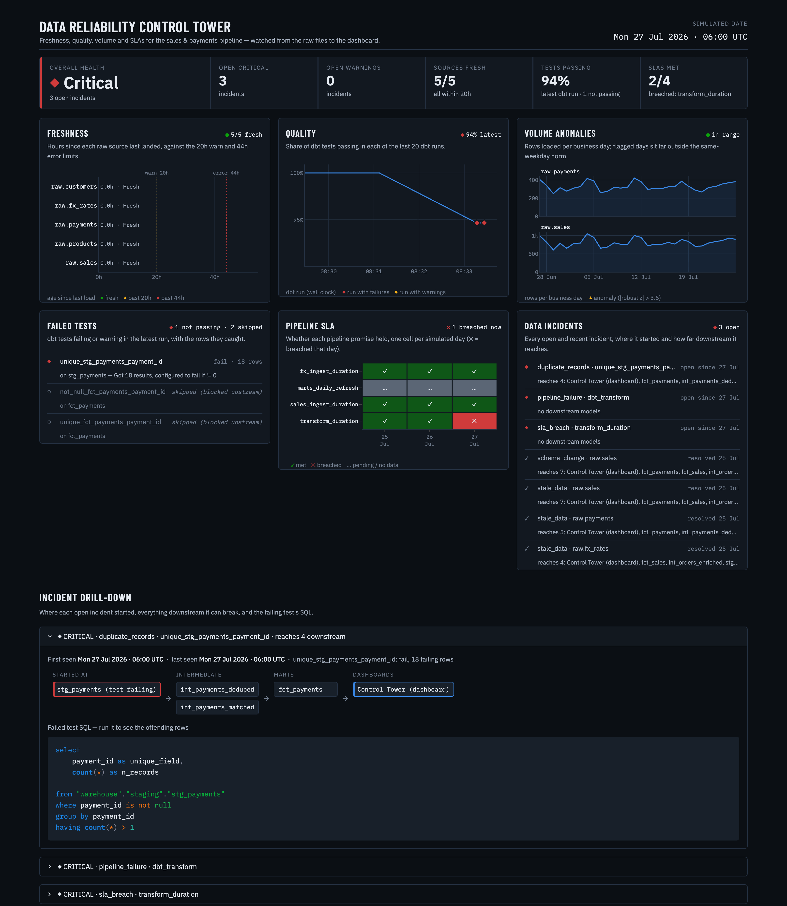
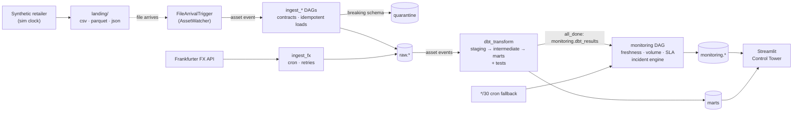

# Data Reliability Control Tower

<!-- CI badge: add once the repo is on GitHub, e.g.
[](https://github.com/<owner>/<repo>/actions/workflows/ci.yml)
-->

> **Most analytics failures don't start in the dashboard. They start much earlier.**

A miniature, production-shaped data platform where the interesting part is everything *before*
the dashboard. Then I break it on purpose, eight different ways, and the platform detects,
explains and auto-resolves every failure.

## The 30-second summary

- **What it is:** a fictional UK online retailer, with sales, payments, customers, products and
  live FX rates. The data goes through Python ingestion, a raw layer, dbt and a monitoring layer,
  and ends in a Streamlit "Control Tower".
- **What makes it interesting:** a chaos toolkit injects real-world failures: duplicates, missing
  dates, broken foreign keys, schema changes, negative revenue, stale data, volume spikes and a
  flaky API. Generic detectors catch every one of them. None of the detectors is keyed to the
  injected case.
- **What you see:** incidents that open, explain their blast radius, and resolve on their own
  once the data is fixed. `make verify-scenarios` proves it end to end: **8/8 scenarios detected
  and resolved** on the live stack.
- **Stack:** Airflow 3.3.2 (Assets and event-driven scheduling), dbt-core 1.12.6 with
  dbt-postgres 1.10.2, Postgres 16, Python 3.12, Streamlit and Plotly. It all runs in Docker.
- **One command:** `make demo` takes you from a fresh clone to a seeded, monitored stack in about
  two minutes, once the images are built.



<sub>Above: a `duplicates` incident. The failing `unique` test, the models and dashboard it
reaches, and the SQL to find the offending rows. The healthy state is shown in
[`docs/img/control-tower-healthy.png`](docs/img/control-tower-healthy.png).</sub>

## Architecture



Only FX runs on a cron. Every file source is event-driven: a custom, non-deleting file-arrival
trigger feeds Airflow Assets, and the asset graph carries the work through to dbt and monitoring.
See [`docs/architecture.md`](docs/architecture.md) for the full diagram, the asset graph and the
incident lifecycle.

## Quickstart

You need **OrbStack or Docker** (with Compose v2), about 4 GB of RAM for Docker (the idle stack uses about 2 GB, measured with `docker stats`), and internet access
for the FX API. Nothing else is installed on your machine. Python, dbt and Airflow all run in
containers.

```bash
git clone <repo-url> data-reliability-control-tower
cd data-reliability-control-tower
make demo      # make up → make seed → make simulate-day DAYS=3 → make monitor
```

`make demo` copies `.env.example` to `.env` if you have no `.env` yet. The first run builds the
images, which takes a few minutes. After that, the whole demo takes about two minutes.

To run it step by step instead:

```bash
make up                    # build and start the stack
make seed                  # 90 days of history; the sim clock starts the next day
make simulate-day DAYS=3   # "run the business" for three more days
make monitor               # force a monitoring cycle and wait for it
```

`make seed` runs once per stack. A second run stops with `already seeded`. Use `make nuke` to
start again from scratch. `make demo` is safe to repeat: on an already-seeded stack it skips the
seed (it still syncs FX) and simulates three more days, so `make up && make seed && make demo`
works too.

Every port is bound to `127.0.0.1` (localhost only), so nothing is reachable from your network.

| Open | URL |
| --- | --- |
| Control Tower | <http://localhost:8501> |
| Airflow UI (no login in this dev setup; bound to localhost only) | <http://localhost:8080> |
| Warehouse (psql) | `make psql`, or `localhost:5433` |
| dbt docs and lineage | `make docs`, then <http://localhost:8081> |

### Break something

```bash
make chaos SCENARIO=duplicates    # the next simulated day re-sends ~5% of payments
make simulate-day                 # files land; Airflow picks them up via Assets
make monitor                      # the incident opens in the Control Tower
make chaos-reset                  # the source re-sends clean files to _resend/
make reprocess FROM=<date> TO=<date>   # chaos-reset prints the exact dates
make monitor                      # the incidents resolve on their own
```

`make verify-scenarios` runs inject → detect → fix → resolved for all eight scenarios. It
takes about 12–14 minutes.

### Every command

| Command | What it does |
| --- | --- |
| `make up` / `make down` / `make nuke` | Start; stop; stop and delete every `drct` container, volume and network, and empty `landing/` |
| `make seed` | Generate 90 days of history and start the sim clock |
| `make simulate-day [DAYS=n]` | Advance the sim clock and deliver the next day's files (and sync FX) |
| `make chaos SCENARIO=x [PARAMS="k=v"]` | Corrupt the next simulated day |
| `make chaos-reset` | Chaos off; clean files re-sent for the affected dates |
| `make reprocess FROM=d TO=d` | Run the `reprocess` DAG over a sim-date range and wait for idle; exits non-zero if the run fails |
| `make replay-quarantine SOURCE=s` | Move the files quarantined by this stack back to landing (anything else in `_quarantine/` is left and reported) |
| `make monitor` | Trigger a monitoring cycle and wait for idle; exits non-zero if the run fails |
| `make verify-scenarios` | End-to-end check of all eight scenarios |
| `make test` / `make test-dags` | pytest (unit and integration) in the app container; DAG tests in Airflow |
| `make health` / `make logs` / `make psql` | Health check (needs `jq`), logs, warehouse shell |
| `make dbt-deps` / `make dbt-build` / `make docs` | dbt from the app container |

## Failure scenarios

Each scenario corrupts the next simulated day in a realistic way. The detectors are generic rules.
They never read the chaos switches.

| Scenario | Injection (defaults) | Detected by | Incident | Panel | Fix |
| --- | --- | --- | --- | --- | --- |
| `duplicates` | ~5% of payment rows re-sent | dbt `unique` on `stg_payments.payment_id` (error) | `duplicate_records`, critical | Failed tests, Quality, Incidents | `chaos-reset` → `reprocess` |
| `missing_dates` | ~3% of sales `order_date` nulled | dbt `not_null` (error) | `missing_values`, critical | Failed tests, Quality | `chaos-reset` → `reprocess` |
| `broken_fk` | ~2% of sales lines point at unknown products | dbt `relationships` (error) | `broken_reference`, critical | Failed tests, Quality | `chaos-reset` → `reprocess` |
| `schema_change` | sales `unit_price` renamed to `price` (or `PARAMS="mode=add"` adds a column) | ingestion contract diff; the file is quarantined | `schema_change`, critical (an added column gives `schema_drift`, warning) | Incidents | re-send, **or accept**: add a contract alias, bump `version`, `replay-quarantine` |
| `negative_revenue` | ~2% of sale lines get a negative price | `dbt_expectations` range test (warn) | `out_of_range`, warning | Quality, Failed tests | `chaos-reset` → `reprocess` |
| `stale_data` | payments stop arriving | dbt source freshness against the sim clock (warn 20h, error 44h), plus the cron-fallback monitor | `stale_data` | Freshness | `chaos-reset` → the next `simulate-day` delivers again |
| `volume_spike` | 8× the day's orders (`multiplier<1` gives a drop) | robust z-score on daily row counts | `volume_anomaly`, warning | Volume anomalies | `chaos-reset` → `reprocess` |
| `api_flaky` | the FX task fails its first two tries | retries with exponential backoff succeed, but the run breaches its 30 s SLA | `sla_breach` (`fx_ingest_duration`) | Pipeline SLA | `chaos-reset` → the next FX run |

The blocking (error) scenarios also open `pipeline_failure` (`dbt_transform`) and
`sla_breach` (`transform_duration`). That is the circuit breaker working: the build stops, and the
marts keep yesterday's good data. The same fix resolves them all.

## Design decisions and trade-offs

**1. The simulated clock is the single "now".**
`control.sim_now()` drives freshness, the lag SLA, the volume window and incident timestamps.
dbt source freshness is made sim-aware by overriding `collect_freshness`. Rows carry both
`_loaded_at` (real, for audit) and `_sim_loaded_at` (what freshness reads). The calendar sits on
real past dates, so the FX API has real rates for every sim day.
*Trade-off:* "stale for two days" can be demonstrated in seconds. But run durations are still real
time, so duration SLAs and the lag SLA's grace period use the wall clock.

**2. Assets and a custom file-arrival trigger, not cron.**
Each landing folder is an Airflow Asset with an `AssetWatcher`. The built-in `FileDeleteTrigger`
deletes the file it fires on, so I wrote `FileArrivalTrigger`. It fires once per new batch, never
touches files, and forgets names that leave the folder, so a re-sent file fires again. dbt runs on
`(raw.sales & raw.payments) | raw.customers | raw.products | raw.fx_rates`. Only FX, an API with
nothing to watch, runs on cron.
*Trade-off:* the trigger's memory is in-process, so a triggerer restart can fire again. That is
harmless, because a run loads every pending file and an extra event is a no-op.

**3. Monitoring runs on `all_done`, and a failed detector fails the run.**
An Asset is only emitted when its task succeeds, so a failing dbt test would never wake a monitor
scheduled on the marts. `publish_dbt_artifacts` therefore runs on `all_done` and emits
`monitoring.dbt_results`. Inside the monitoring DAG every detector runs on `all_done`, so one broken
detector cannot hide the others' incidents. The final `incidents` task reconciles first, then fails
the run if any detector failed, so the failure surfaces as a `pipeline_failure` instead of a quiet
green run. A `*/30` cron leg catches stale data, which produces no events at all.

**4. A reprocess DAG, and native backfill where it fits.**
Airflow's native backfill only works on time-scheduled DAGs, and it walks real logical dates, not
sim dates. File sources use a manual `reprocess` DAG with `start`/`end` sim dates instead. It
prefers re-sent files in `_resend/` over `_processed/`, reloads idempotently (delete-then-insert
per `(source, business_date)`), and emits the raw Assets, so dbt and monitoring follow on their own.
FX is time-scheduled, so it shows native backfill too. Use **single-day windows**, one at a time:

```bash
docker compose exec airflow-scheduler \
  airflow backfill create --dag-id ingest_fx --from-date 2026-07-20 --to-date 2026-07-20
```

A multi-day range on the `*/10` cron would create about 144 runs per day. Airflow also allows only
one running backfill per DAG.

**5. A robust z-score with a same-weekday baseline and a MAD floor.**
Volume uses median/MAD rather than mean/stdev, so one past spike cannot poison the baseline. Each
day is compared with the previous **8 same-weekday** dates, because a plain 14-day window flagged
normal Saturdays. The detector needs at least 7 of them, and flags at `|z| > 3.5`. MAD is floored
at 5% of the median: eight samples gave a MAD of about 2%, which flagged about 2% of clean days.
With the floor there were 0 false positives in 351 clean evaluations, and an 8× spike still scores
z ≈ 75–80.
*Trade-off:* a real ±18% weekday swing no longer flags, and about seven weeks of history are needed.

**6. Circuit-breaker severities.**

| Severity | dbt tests | Effect |
| --- | --- | --- |
| `error` (blocking) | `unique`, `not_null`, `relationships` | The build stops before the marts. The marts keep yesterday's good data and go stale, which feeds the SLA panel. |
| `warn` | negative-revenue range, missing sales dates | Data flows through, and an incident is still raised. |

Staging deliberately does **not** deduplicate, so tests see the data as it arrived. Deduplication
happens in intermediate. Incident severity follows: dbt error, freshness error, breaking schema,
SLA breach and pipeline failure are critical. dbt warn, freshness warn, additive schema and volume
anomalies are warnings. *The story: bad data never reached the dashboard, and an incident explains
why it is a day behind.*

**7. Generic detectors, never keyed to chaos.**
Only the generator and the FX task read `control.chaos_state`. Detectors look at dbt results,
freshness, row counts, schema diffs and run records, the signals a real incident would produce.
The incident engine turns them into generic checks. The identity is `(type, asset)`, with at most
one open incident each. A passing check auto-resolves. The Control Tower reads through a
read-only role that cannot read the `control` tables at all (it may only call `control.sim_now()`).

## Repo layout

```text
├── Makefile              the single entry point
├── docker-compose.yml    project "drct": warehouse, Airflow (metadata DB, init, API server,
│                         scheduler, DAG processor, triggerer), Control Tower, app
├── docker/               airflow.Dockerfile, app.Dockerfile (dbt in its own venv)
├── airflow/dags/         ingest_files (4 event-driven DAGs), ingest_fx, dbt_transform,
│                         monitoring, reprocess
├── dbt/                  models/{staging,intermediate,marts}, tests, macros (sim-aware freshness)
├── src/drct/
│   ├── generator/        seeded synthetic retailer and the sim-day writer
│   ├── chaos/            the eight scenarios and their switches
│   ├── ingestion/        contracts (YAML), readers, loader, quarantine, FX client
│   ├── orchestration/    Assets, FileArrivalTrigger, run callbacks
│   ├── monitoring/       dbt artifacts, volume, SLA, checks, incidents, lineage
│   ├── control_tower/    the Streamlit app
│   ├── ops/              the CLI behind make (seed, chaos, reprocess, verify-scenarios)
│   └── common/           config, DB, sim clock, structured logging, Airflow API client
├── warehouse/init/       schemas, raw tables, monitoring tables, roles
├── tests/                unit, integration (throwaway DBs), dags (in the Airflow container)
├── scripts/              healthcheck.sh, ci_smoke.sh
└── docs/                 architecture, demo script, LinkedIn draft, project plan
```

CI (`.github/workflows/ci.yml`) runs ruff, pytest, and a `dbt build` smoke test against a Postgres
service container.

## Known limitations and operator notes

| Note | What to do |
| --- | --- |
| Pressing Ctrl-C during `make verify-scenarios` leaves the verifier running in its `app` container | `docker ps --filter name=drct-app-run` and `docker stop` it |
| The host sleeping mid-run breaks timing in long runs (macOS) | Wrap them: `caffeinate -dims make verify-scenarios` |
| The `stale_data` fix (the next delivery) leaves clean re-sent files in `_resend/` for the skipped days | Harmless. Run `make reprocess FROM=… TO=…` if you want the missed days loaded too. |
| Control Tower theme or query edits don't show up | `docker compose restart control-tower` |
| An old local `.env` lacks newer variables | Re-copy it: `cp .env.example .env` |
| `make health` fails with `jq: command not found` | `scripts/healthcheck.sh` needs `jq` on the host |
| `make dbt-build` / `make docs` on a fresh clone fail on missing packages | Run `make dbt-deps` first. The Airflow DAGs install packages on their own. |
| The Control Tower caches queries for 15 s | Reload the page after a `make monitor` |
| `.env.example` holds placeholder dev passwords and keys | Fine for local use. Never reuse them anywhere real. |

## What I'd do next

- **Alerting:** route new critical incidents to Slack or PagerDuty, with the blast radius in the
  message.
- **Per-model orchestration:** run dbt through Cosmos, so a failing model shows up as a failing
  Airflow task and lineage is visible in Airflow too.
- **Hardening:** key the trigger's memory on name, mtime and inode; add an advisory lock around the
  incident reconcile instead of relying on `max_active_runs=1`; add tie-breakers to the "latest
  result" queries.
- **Deadline Alerts:** try Airflow's Deadline Alerts alongside the config-driven SLAs.
- **Commercial analytics:** build the KPI layer on top of the now-trustworthy marts. That's the next
  project.

## Licence

[MIT](LICENSE)
