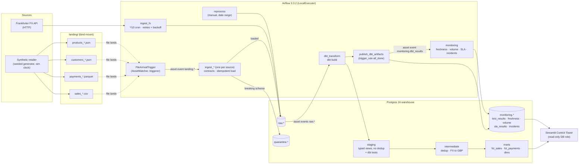
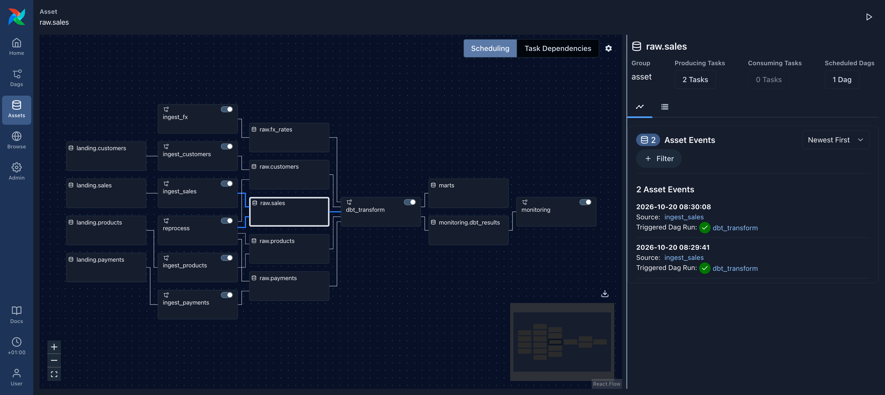
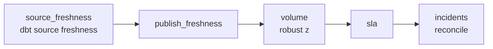

# Architecture

The Control Tower watches a small, production-shaped pipeline: five sources go through Python
ingestion, a raw layer, dbt and a monitoring layer, and end in a Streamlit dashboard. Everything
runs in one docker compose project (`drct`). Nothing is installed on the host apart from OrbStack
or Docker.

## Data flow



| Layer | What happens | Where |
| --- | --- | --- |
| Sources | A seeded generator writes one day of files per source per simulated day. FX rates come from the real Frankfurter API. | `src/drct/generator/`, `src/drct/ingestion/fx.py` |
| Ingestion | Every file is checked against a YAML data contract. Additive changes load with a `schema_drift` warning. Breaking changes are quarantined. Loads are delete-then-insert per `(source, business_date)`, so reruns are safe. | `src/drct/ingestion/` |
| Raw | Source columns are stored as `text`, plus `business_date`, `_loaded_at`, `_sim_loaded_at`, `_source_file`, `_batch_id` and `_extra jsonb`. | `warehouse/init/03_raw.sql` |
| dbt | Staging types and renames, and does **not** deduplicate, so tests see the data as it arrived. Intermediate deduplicates and converts to GBP. Marts hold the facts and dimensions. One `dbt build` per run means one `run_results.json` to publish. | `dbt/` |
| Monitoring | Parses dbt artifacts, runs the freshness, volume and SLA detectors, and reconciles incidents. | `src/drct/monitoring/`, `airflow/dags/monitoring.py` |
| Control Tower | Six panels plus an incident drill-down, read through a read-only role. | `src/drct/control_tower/` |

## The Airflow asset graph



The screenshot is Airflow's own asset graph (Assets → `raw.sales`). Reading it left to right:

| Asset | Produced by | Consumed by |
| --- | --- | --- |
| `landing.<source>` (`file:///opt/drct/landing/<source>`) | the `FileArrivalTrigger` watcher | `ingest_<source>` |
| `raw.<source>` (sales, payments, customers, products) | `ingest_<source>.load`, `reprocess.reload` | `dbt_transform` |
| `raw.fx_rates` | `ingest_fx.sync` | `dbt_transform` |
| `marts` | `dbt_transform.mark_marts` (only when the whole build succeeds) | nothing; it records that the marts are current |
| `monitoring.dbt_results` | `dbt_transform.publish_dbt_artifacts` (always, on `all_done`) | `monitoring` |

`dbt_transform` is scheduled on a conditional asset expression:

```python
(raw.sales & raw.payments) | raw.customers | raw.products | raw.fx_rates
```

Sales and payments are transformed together, because payments are matched to orders. Every other
source can trigger a build on its own.

`monitoring` uses `AssetOrTimeSchedule`: it runs on the `monitoring.dbt_results` asset **or** a
`*/30` cron. The cron leg matters for stale data, because a source that stops delivering never
produces an event to wake anything up.

## File-arrival triggering

File ingestion is event-driven, using Airflow 3 Assets. Nothing is cron-scheduled except FX.

- Each landing folder is an Asset, `landing.<source>` (`file:///opt/drct/landing/<source>`).
  It carries an `AssetWatcher` whose trigger is `drct.orchestration.triggers.FileArrivalTrigger`,
  a custom `BaseEventTrigger`. The triggerer runs one poll loop per source (every 5 s).
- The trigger remembers which file names it has already reported. It fires one asset event per
  landing batch, not one per poll. It forgets names that leave the folder, so a re-sent file with
  the same name fires again. It only reads the folder: it never moves or deletes files.
  Sub-folders (`_processed/`, `_quarantine/`, `_resend/`), dotfiles and temp files are ignored.
- `ingest_<source>` is scheduled on `[landing.<source>]` with `max_active_runs=1`. Its `load` task
  loads every pending file, moves each to `_processed/` or `_quarantine/`, and emits the
  `raw.<source>` Asset. A duplicate event therefore only causes a harmless no-op run.
- `ingest_fx` is the exception: an API has no file arrival to watch, so it runs on a
  `*/10 * * * *` cron. It also supports native `airflow backfill create` runs, which reload one
  logical date without moving the sync watermark.

**Path used: AssetWatcher + custom trigger (the primary design).** It works at Airflow 3.3.2.
The built-in `FileDeleteTrigger` was not an option because it deletes the file it fires on. The
planned fallback, a `watch_landing` DAG with deferrable `FileSensor`s, was not needed.

## Monitoring and the incident lifecycle



- Every task after `source_freshness` runs on `all_done`, so one failed detector cannot stop the
  others, and `incidents` always reconciles what was recorded.
- `incidents` then checks the states of its upstream tasks. If any failed, it fails the run
  *after* reconcile has committed. The failure is visible, and the next cycle opens a
  `pipeline_failure` incident for it.
- The incident engine turns every detector's latest output into generic checks
  (`type, asset, passed, severity`). A failing check opens an incident, or updates `last_seen` on
  the open one. The identity is `(type, asset)`, with at most one open incident per identity. When
  the same check passes again, the incident resolves on its own.
- The blast radius (`affected_downstream`) comes from dbt's `manifest.json`: every model and
  exposure downstream of the failing node, including the `control_tower` dashboard exposure.

## Time: the simulated clock

`control.sim_clock` holds one row, and `control.sim_now()` returns it. Freshness, the lag SLA,
`first_seen`/`last_seen` and the volume window all compare against it. dbt source freshness is made
sim-aware by overriding `collect_freshness` (`dbt/macros/collect_freshness.sql`). `_loaded_at`
stays real wall-clock time for audit. `_sim_loaded_at` is what freshness reads.

The simulated calendar sits on real past dates (day 0 is 180 days before the first seed), so the
FX API has real rates for every simulated day.

## Containers

| Service | Purpose | Host port |
| --- | --- | --- |
| `warehouse` | Postgres 16: `raw`, `quarantine`, `staging`, `intermediate`, `marts`, `monitoring`, `control` | 127.0.0.1:5433 |
| `airflow-db` | Airflow metadata (Postgres 16) | none |
| `airflow-apiserver` | Airflow UI and REST API | 127.0.0.1:8080 |
| `airflow-scheduler`, `airflow-dag-processor`, `airflow-triggerer` | LocalExecutor scheduling; the triggerer runs the file watchers | none |
| `control-tower` | Streamlit, as the `control_tower_ro` role | 127.0.0.1:8501 |
| `app` (profile `tools`) | Short-lived: ops CLI, tests, dbt, `make docs` | 127.0.0.1:8081 (only for `make docs`) |

dbt runs in its own virtualenv (`/opt/dbt-venv`) inside both images, so its dependencies never
conflict with Airflow's constraints.
